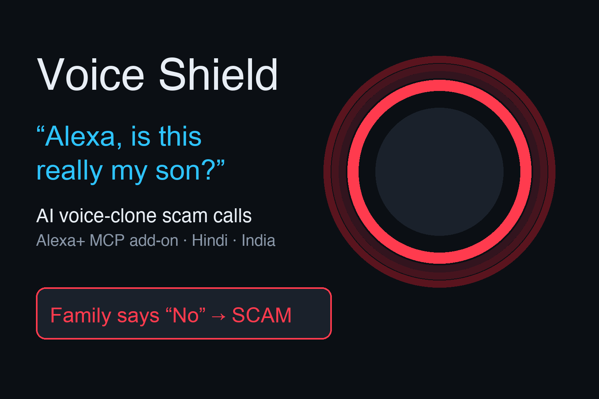
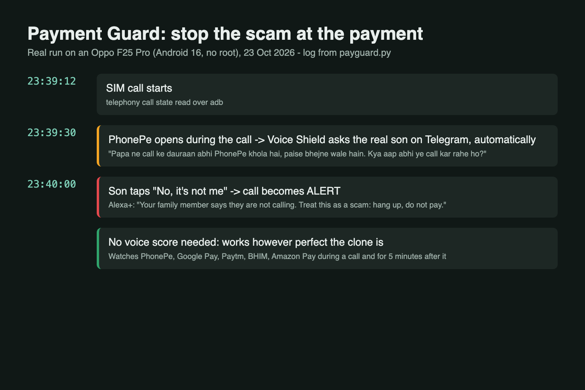
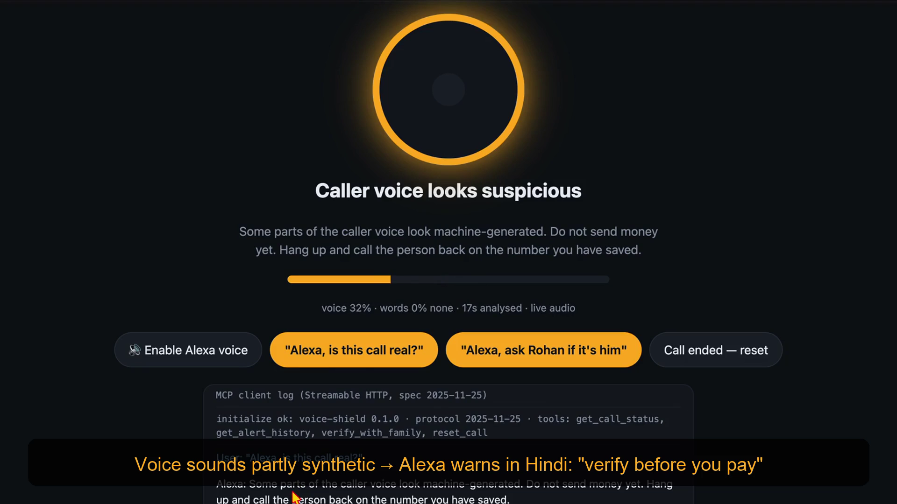
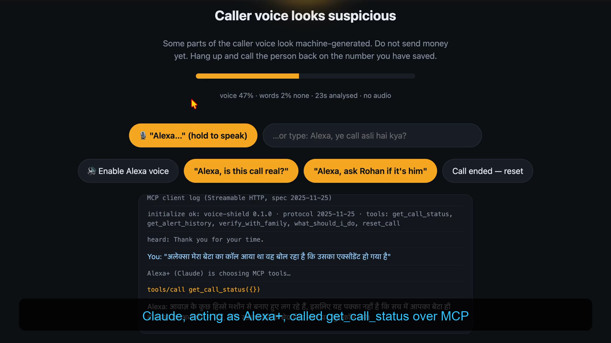
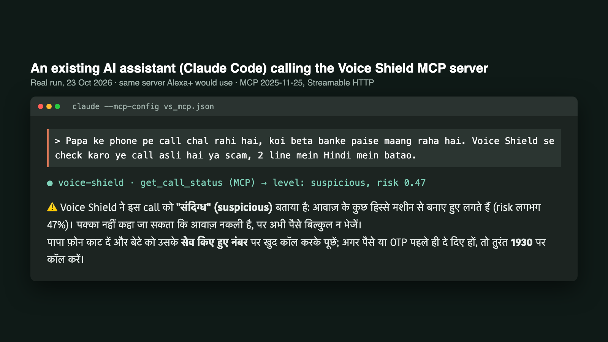
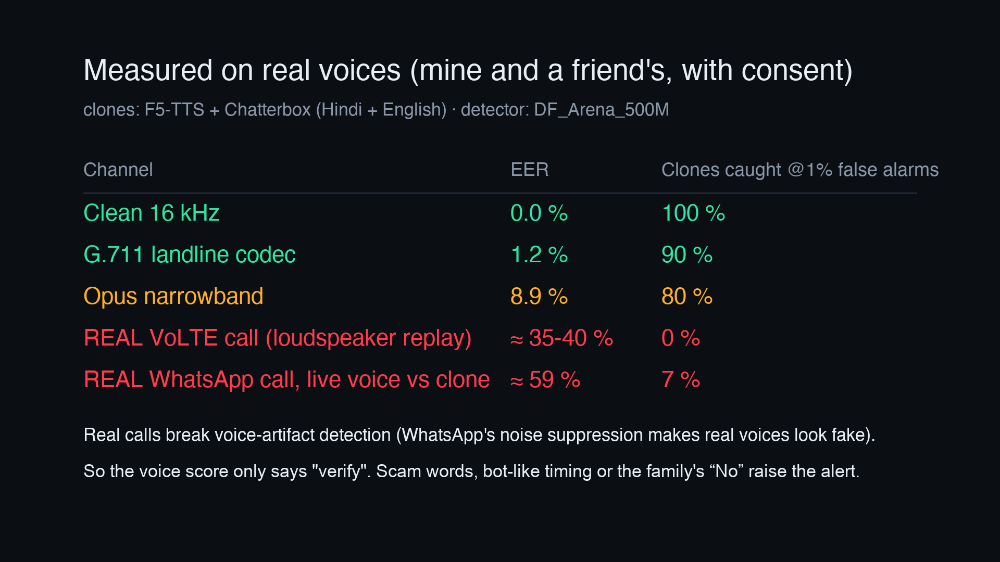
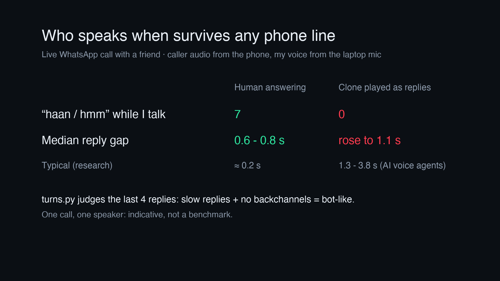
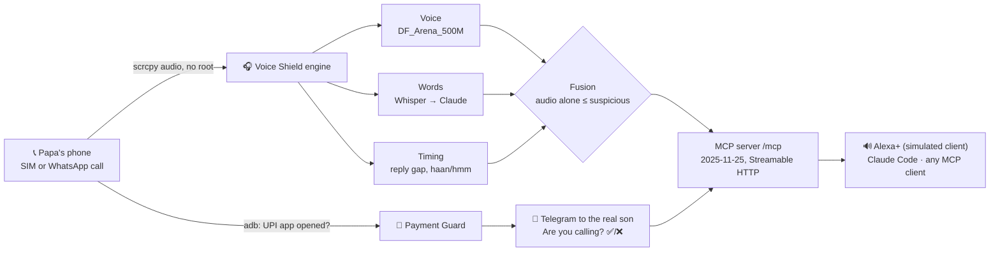
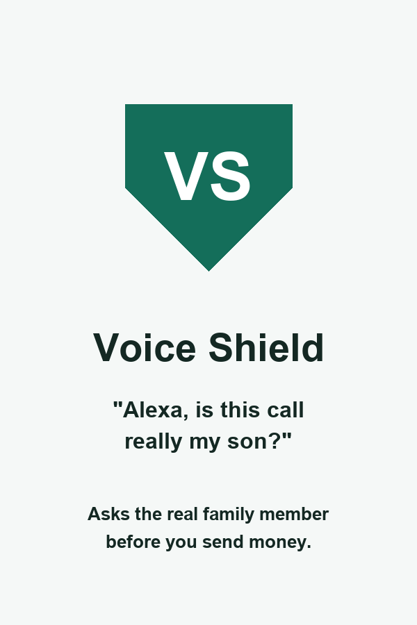

<div align="center">



# 🛡️ Voice Shield

### "Alexa, is this really my son calling?"
An Alexa+ MCP add-on that checks live phone and WhatsApp calls, asks the real family member to confirm, and stops the payment before the money moves.

**Amazon Developer Hackathon 2026 · Alexa+ track · Open Source**

[](https://youtu.be/Lkfjvd8oUys)
[](server.py)
[-2ea44f)](#-ready-for-the-alexa-mcp-toolkit)
[](#-live-sim-call-capture-android-no-root)
[](content.py)
[](requirements.txt)
[](LICENSE)

</div>

---

A scammer clones your voice from a 10-second Instagram clip, calls your father and says *"Papa, mera accident ho gaya, abhi ₹25,000 bhej do, kisi ko mat batana."* Voice Shield listens to the **real call** on the phone, reads it for scam pressure, and, the part no clone can beat, **asks the real son on his own phone: "Are you calling right now?"** If Papa opens PhonePe or Google Pay during the call, it asks the son **before the money moves**. Alexa+ then tells Papa what to do, in Hindi.

> 🇮🇳 India reported **₹22,495 crore** of cyber-fraud losses in 2025; "digital arrest" alone peaked at 1.24 lakh complaints in 2024. Every official advisory (FBI, FTC, RBI, Indian police) says the same thing: *don't trust the voice, call them back.* Voice Shield automates exactly that advice.

## ✨ What it does

| | |
|---|---|
| 📞 **Listens to the real call** | Both sides of a SIM (VoLTE) call, or the caller side of a WhatsApp call, from a stock Android phone over USB. No root, no app install. |
| 🧠 **Three independent signals** | **Voice:** DF_Arena_500M anti-spoof. **Words:** on-device Whisper, then Claude classifies scam pressure (urgent money, OTP, secrecy, police threats). **Timing:** who speaks when; real people say "haan/hmm", a played clone never does. |
| 👨‍👩‍👦 **Asks the real person** | `verify_with_family` sends "Are you calling right now? ✅/❌" to the son's Telegram. A clone can copy a voice; it cannot press his button. |
| 💸 **Payment Guard** | A UPI app (PhonePe, Google Pay, Paytm, BHIM, Amazon Pay) opening during the call triggers that question automatically, before any money moves. |
| 🗣️ **Alexa+ answers in Hindi** | 5 MCP tools; the official RBI / 1930 / cybercrime.gov.in steps are fixed text, never generated. |
| ⚖️ **Honest by design** | Voice scores fail on real WhatsApp calls (we measured ≈59 % EER), so **audio alone never raises an alert**; it only says "verify". |

## 🖼️ Screens

<table>
<tr>
<td width="50%"><br/><sub><b>Payment Guard, real run:</b> PhonePe opens during the call → son asked on Telegram → "No" → alert</sub></td>
<td width="50%"><br/><sub><b>The real son taps "No"</b> on his own phone; the call becomes an alert</sub></td>
</tr>
<tr>
<td><br/><sub><b>Claude as Alexa+</b> calls <code>get_call_status</code> over MCP and answers in Hindi</sub></td>
<td><br/><sub><b>Claude Code</b> calling the same MCP server (real run)</sub></td>
</tr>
<tr>
<td><br/><sub><b>Measured on real calls:</b> the voice detector fails on WhatsApp</sub></td>
<td><br/><sub><b>Timing layer:</b> 7 backchannels from the real friend, 0 from his clone</sub></td>
</tr>
</table>

## 🧭 How it works



**Fusion rule (`engine.fuse`):** family says No → alert; words risk ≥ 0.6 → alert; words ≥ 0.3 *and* voice alert or bot-like timing → alert; voice alone → at most suspicious. A human decides via `verify_with_family`. The voice score alone never tells the user to hang up; it tells them to verify.

## 🔧 MCP tools

| Tool | Returns | Alexa+ use |
|---|---|---|
| `get_call_status()` | `level` (listening/safe/suspicious/alert), calibrated `risk`, `say` | "Alexa, is this call real?" |
| `verify_with_family(claimed_person, reason)` | `answer` yes/no/no_answer + `say` | "Alexa, ask Rohan if it's him" → button on Rohan's phone |
| `what_should_i_do(money_sent, shared_otp_or_pin, language)` | ordered steps, fixed authority text (en/hi) | "Alexa, maine paise bhej diye, ab kya karun?" |
| `get_alert_history(limit)` | recent alerts | "Alexa, were there scam calls this week?" |
| `reset_call()` | — | call ended |

All tools return `structuredContent` plus a text block, the shape Alexa+'s MCP client expects. `SKILL.md` teaches any agent how to use them.

Any MCP-capable assistant can use the same server, for example Claude Code: `claude mcp add --transport http voice-shield http://127.0.0.1:8000/mcp`, then ask "is this call real?".

## 🚀 Run it

Needs macOS/Linux, Python 3.12+, ffmpeg, ~3 GB disk for the model (downloaded on first run).

```sh
python3 -m venv .venv && .venv/bin/pip install -r requirements.txt
.venv/bin/python test_engine.py        # detector self-check (synthetic → alert, silence → nothing)
.venv/bin/python test_mcp.py           # MCP 2025-11-25 handshake + tools over Streamable HTTP
.venv/bin/python server.py --source file:demo.wav   # replay a clip
.venv/bin/python server.py --source mic             # call on speakerphone, laptop listens
.venv/bin/python server.py --source phone           # live SIM call from a USB-connected Android (scrcpy)
```
Open **http://localhost:8000/** — the page is a real MCP client (initialize → tools/list → tools/call) rendered as an Alexa light ring with spoken replies. Press *"Alexa, is this call real?"* and *"Alexa, ask Rohan if it's him"*.

Public HTTPS for a remote client: `cloudflared tunnel --url http://localhost:8000`, then restart with `PUBLIC_HOST=<name>.trycloudflare.com`. The server runs in JSON-response, stateless mode because quick tunnels do not pass SSE.

Optional: `.env` with `ANTHROPIC_API_KEY` (words layer on **Claude Opus 5.5** with structured JSON output: it scored an ordinary "Didi, put 5,000 in my account, I'll return it Sunday" at 0.10 where keywords said 0.30, and still flagged a garbled phone-ASR fragment with "police case… paise… jaldi" at 0.55), `TELEGRAM_BOT_TOKEN` / `TELEGRAM_FAMILY_CHAT_ID` (family verification) and AWS credentials (`AWS_ACCESS_KEY_ID`…) to route the words layer through **Amazon Bedrock Nova Micro** (code path written, not yet run against the live service); without them the words layer uses an offline keyword classifier, and only transcript text ever leaves the device, never audio.

### 📱 Live SIM call capture (Android, no root)
`scrcpy --audio-source=voice-call` returns both sides of a VoLTE call on **Oppo F25 Pro / ColorOS 16 / Android 16** with USB debugging on ("Disable permission monitoring" + USB mode *File transfer*). Many other OEM builds return silence; the engine is source-agnostic, so the mic path works everywhere. Production would move the same engine into an OEM dialer or carrier IMS layer, as Google's Pixel Scam Detection and LG U+ ixi-O do.

## ✅ Ready for the Alexa+ MCP Toolkit

<p align="center"> &nbsp; </p>

Alexa+ add-on tools are partner-only, so we could not deploy, but the server is built to Amazon's published MCP Toolkit requirements, and `alexa/addon.json` is the add-on manifest in the QuickStart format (listing, example phrases, privacy/terms links, all six icon sizes, a 600x900 carousel image, MCP endpoint). Set the endpoint to your tunnel URL; we have not validated it with the private `alexa-ai` CLI.

| Requirement (Alexa+ MCP QuickStart) | Voice Shield |
|---|---|
| MCP 2025-11-25, Streamable HTTP | yes (`test_mcp.py` checks the handshake) |
| Public HTTPS URL, tunnel OK for dev | Cloudflare quick tunnel (stateless, JSON responses) |
| Round-trip under 500 ms | measured over HTTP on M1: median 1.2-1.3 ms, p95 under 3 ms for `get_call_status`, `what_should_i_do`, `get_alert_history` (50 calls each) |
| Structured results | `structuredContent` plus a text block; read-only tools annotated |

## 💸 Payment Guard: stop the scam at the payment
A scam ends at the payment, not at the call. While a call is on (and for 5 minutes after it), Voice Shield watches which app is open on the parent's phone over adb, no root. The moment PhonePe, Google Pay, Paytm, BHIM or Amazon Pay opens, it asks the real son on Telegram by itself, before any money moves: "Papa ne call ke dauraan abhi PhonePe khola hai, paise bhejne wale hain. Kya aap abhi ye call kar rahe ho?" His "No" turns the call into an alert, and `get_call_status` tells Alexa+ to say "wait, your family member is confirming". No voice score is involved, so it works however perfect the clone is. Real run on the Oppo F25 Pro: call started 23:39:12, PhonePe opened 23:39:30 and the question went out the same second, "No" arrived 23:40:00 (`payguard.py`).


## 📊 The numbers (measured, our own voice)

<p align="center"></p>

Test set: one consenting team member's voice (bona fide, 4 recordings, 512 four-second windows) versus clones of that voice made with two open tools on the same laptop, **F5-TTS** (MLX) and **Chatterbox-Multilingual** (Hindi + English), reading scam scripts from `data/scripts.txt`. Channel conditions simulated with ffmpeg (`eval.py`).

| Condition | EER | TPR @ 1 % FPR | real-call false alarms (3-of-5 consensus) |
|---|---|---|---|
| Clean 16 kHz | **0.0 %** | 100 % | 0 / 4 |
| Band-limited 300–3400 Hz | 0.8 % | 90 % | — |
| G.711 µ-law (landline) | 1.2 % | 90 % | 0 / 4 |
| Opus narrowband 12 kb/s | **8.9 %** | 80 % | **3 / 4** |
| Opus wideband 24 kb/s, *codec only* (simulated) | 0.0 % | 100 % | — |
| **REAL WhatsApp call** (friend's phone → WhatsApp → our Oppo, remote audio captured digitally with scrcpy `playback --audio-dup`): live human vs clone of the same voice | **≈ 59 %** | 7 % | — |
| same call: replayed recording of that human vs clone | ≈ 48 % | 13 % | — |
| iLBC 8 kHz (VoIP / SIM-box style) | 10.1 % | 80 % | — |
| Loudspeaker replay into a real VoLTE call (laptop speaker → friend's phone mic → network → our Oppo, scrcpy) — **worst case** | **≈ 35–40 %** | 0 % | 2 / 3 (audio alone) |

Read these honestly:
- **On real calls the voice detector does not work, on either path we could test.** Simulated codecs looked fine (Opus-WB 0 %), but a real WhatsApp call scored the friend's *live* voice as more synthetic (median 0.58) than his clones (0.22). WhatsApp runs its own noise suppression and automatic gain control before encoding; we had already measured that loudness processing alone turns real speech "synthetic" for this model (`docs/friction_log.md` #4). Codec simulation is not channel simulation.
- That is the finding of this project, and it is why Voice Shield is built so that **audio alone can never raise an alert**: an alert needs scam language in the live transcript (Claude, robust to garbled ASR) or a "No" from the real family member over Telegram, and the turn-taking layer (`turns.py`) adds who-speaks-when evidence that no codec destroys.
- Methodology notes: in the speaker-replay call the "real" class was itself a replay; the WhatsApp call fixed that with a live speaker, but the clones were still played from a laptop speaker into the sending phone, and it is one call with one speaker (N is small, treat as indicative).
- So the design does not trust audio: **the voice layer alone can only raise "suspicious" ("verify this caller"), never "alert".** An alert needs scam language in the live transcript (Whisper on-device → scam classifier) or a ❌ from the real family member. Both of those work identically on a bad phone line, because a clone can copy a voice but not the script it must say or the button on the real son's phone.
- Two clone families are *seen* only in the sense that we chose the calibration on them; the model was not trained on them. Published results for unseen 2024-era generators are 25–33 % EER and 40–50 % on multilingual in-the-wild sets that include Hindi ([Deepfake-Eval-2024](https://arxiv.org/abs/2503.02857), [ML-ITW](https://arxiv.org/abs/2603.05852)). Real-time voice conversion (RVC/Seed-VC) was not tested.
- Model swap evidence: NII AntiDeepfake-Small (ported without fairseq in `antideepfake.py`) scored our own voice 0.00 but **missed** the F5 clones (0.02–0.47); DF_Arena_500M caught them all, so it is the live model.
- `ffmpeg loudnorm` on the real recordings turned them "synthetic" (logit margin −11 → +4.6). Static gain only. Details in `docs/friction_log.md`.
- Latency on M1 (8 GB): ~230 ms per 4 s window on MPS, 1 s hop → first alert 3–5 s after cloned speech starts.

## ⏱️ Timing layer (who speaks when)

<p align="center"></p>

`turns.py` pairs the caller's audio (Oppo, `scrcpy --audio-source=playback --audio-dup` during a WhatsApp call) with the user's voice (laptop mic) in 20 ms frames and tracks the caller's reply gap after each user turn and the "haan / hmm" backchannels the caller makes while the user talks. Humans reply in ≈0.2 s and backchannel constantly (Stivers et al. 2009); production AI voice agents reply in 1.3-3.8 s and almost never backchannel (Cekura 2026, Full-Duplex-Bench 2025).

Live WhatsApp call with a consenting friend, 8 questions: while he answered himself he backchannelled 7 times and the median reply gap was 0.6-0.8 s (WhatsApp adds network delay); when he answered by playing his own clone, like a scammer pressing play, backchannels stayed at zero and the median gap rose to 1.1 s. The first version averaged the whole call, so the human half masked the scripted half and no "bot-like" flag fired; it now judges the last 4 replies (`turns.py` self-test covers a human-then-bot call). One call, one speaker: indicative only.

## 🔒 Privacy

Audio is processed on the laptop and discarded after each window; only aggregate risk events are kept. The remote caller's voice is personal data under India's DPDP Act, so no audio is uploaded; the optional Bedrock call receives transcript text only. The clone test set was made from the author's own voice and, with consent, a friend's voice; those recordings are not published in this repository; we declined services that required publishing the voice model.

## 🏗️ What was built during the hackathon

Everything in this repository (21–23 Oct 2026). The idea descends from our SIH 2026 problem-statement design (voice-clone detection on cellular calls), of which no code survived; the capture path, detector evaluation, MCP server, Alexa+ client, Telegram verification and scam-language layer are new.

## 🤝 Built on Digi Sanrakshak

`data/trusted_routes.json` and `data/action_text.json` (the authority-sourced "what to do now" steps behind `what_should_i_do`, in English and Hindi) and the scam-tactic taxonomy come from our team's earlier MIT-licensed project [Digi Sanrakshak](https://github.com/harsh-1-code/Sanrakshak_AI). Those strings are deliberately not generated: they follow RBI, I4C (1930) and cybercrime.gov.in guidance.

## 📜 Licenses

Code: MIT. Model weights are downloaded at runtime and keep their own licenses: `Speech-Arena-2025/DF_Arena_500M_V_1` (non-commercial), `nii-yamagishilab/wav2vec-small-anti-deepfake` (CC BY-NC-SA 4.0, evaluation only). Clone tools used for testing: F5-TTS (CC BY-NC weights), Chatterbox (MIT).
